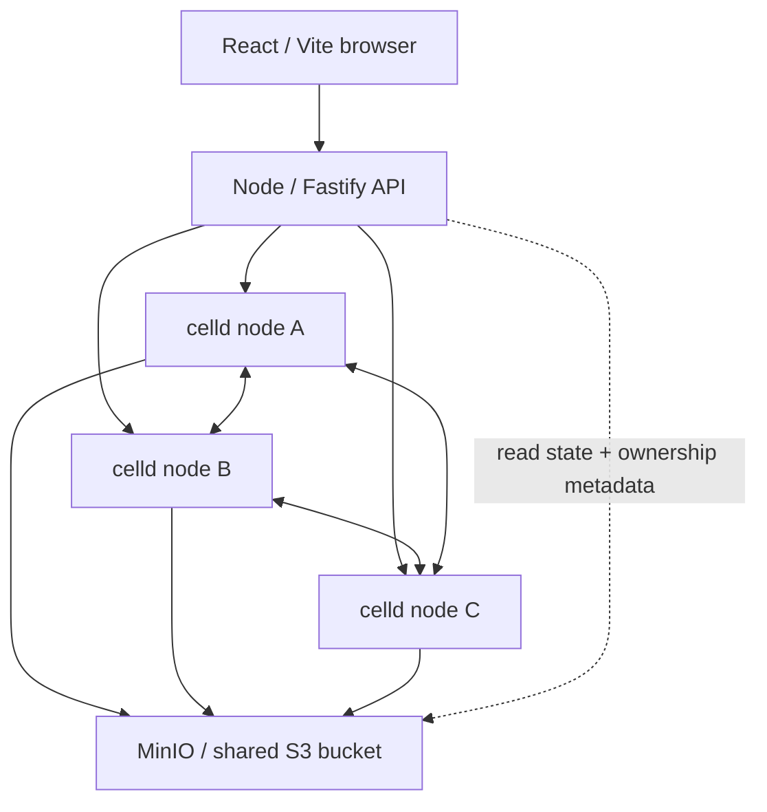

# celld systems lab

A real three-node celld fleet, shared MinIO storage, a Node API, and a React/Vite workbench. Six experiments make routing, ownership, concurrency, recovery, and runtime lifecycle observable.

## Run

Requires Docker Compose v2, Node 22.18+ and pnpm. Allow roughly 4 GB of Docker memory. The first build compiles MinIO from pinned official source because its public images and archived binaries are no longer available; later builds use Docker's cache.

```sh
pnpm install
pnpm lab:up
```

Open [the lab](http://localhost:5173). Everything, including the API and web server, runs in Docker.

[MinIO console](http://localhost:9001): user `celldlab`, password `celldlab-secret`. These are local demo credentials.

```sh
pnpm lab:logs
pnpm lab:down
```

Ordinary stops preserve the four named volumes. To deliberately erase all lab data:

```sh
docker compose down --volumes
```

## Architecture



- **Browser:** chooses a cell name, operation, concurrency, and ingress node. Calls only the Node API.
- **Node API:** submits real HTTP requests; samples each celld internal `/state` endpoint and MinIO metadata every two seconds. Keeps the last 200 request records in memory.
- **Worker:** runs inside celld, using Cloudflare Workers / Durable Object APIs. A deterministic name maps to a `LabCell` with private SQLite storage. Updates and the last 20 events commit synchronously in a transaction.
- **Fleet:** three processes, each with a separate local disk volume. Nodes use their internal listeners for forwarding and replication. Every node sees the same bucket.
- **MinIO:** contains deployment code, cell ownership records, node leases, log bundles, and snapshots. The API reads this metadata; it does not edit celld's records.

The Node server is the gateway and observer. Stateful JavaScript runs in celld's V8 runtime, rather than in Node.

## Experiments

| Experiment | Action | Evidence |
| --- | --- | --- |
| One cell, any node | Increment through A, then B | Ingress differs from the observed owner; the same counter continues |
| A hundred writers | Run 100 simultaneous increments | Baseline +100, 100 distinct revisions, final read |
| Divide the work | Write to three named rooms | Independent values and deterministic IDs; separate ownership records |
| Pull a node | Increment, crash its owner, wait ~10s, read through a survivor | Value retained; owner, epoch and boot ID change |
| Memory is temporary | Increment, leave untouched for 25s, read | Boot ID changes while SQLite value persists |
| Wake up later | Schedule, wait 6s, read | Alarm adds 10 and increments its durable fire count |

The concurrency experiment expects no other writers to its cell while measuring baseline and final state. Experiment names persist across runs; counters are intentionally cumulative.

The lab sets `CELLD_MAX_CELL_REQUESTS=128` so its 100-writer experiment fits. celld's default is 64; overload beyond the configured limit returns 503, recorded as a failed request rather than retried.

The **Run experiment** button automates the concurrency and independent-room experiments. Other experiments pair a first request with explicit instructions; use the console and node controls to complete them. Cell reads are manual so telemetry does not prevent idle eviction.

For failover, distinguish **Stop gracefully** (SIGTERM and handoff) from **Crash** (SIGKILL). After a crash, use a healthy ingress and let the failed node's lease expire. Start stopped nodes afterward. A transient failed request is visible; submit a read again to observe recovery. Writes are never silently retried: losing a response does not prove the operation failed to commit.

## Systems model

1. A name selects a cell, not a machine. All three ingress nodes can address the same cell.
2. `cells/LabCell:<id>/own.json` records its current node and ownership epoch. Conditional bucket writes arbitrate ownership. The owner's node lease expires if renewal stops; there is no fixed cluster leader.
3. Requests arriving elsewhere are routed to the owner. A single cell runs synchronous SQLite updates without interleaving; different cells divide the work. This does not imply asynchronous application code is automatically race-free across `await` boundaries.
4. In `CELLD_DURABILITY=fleet`, a write can become durable on a peer's disk before bucket upload completes. Bucket persistence can also satisfy the durability gate. A single-node fleet must wait for the bucket.
5. An idle runtime can disappear while ownership and durable state remain. A new constructor creates a new boot ID; reads restore the SQLite value. Idle cells can later rebalance.
6. Crash recovery can recover peer log data that has not reached a per-cell snapshot yet. Successful request acknowledgement is the important boundary.

See [celld's overview](https://celld.dev/docs/), [guarantees](https://celld.dev/docs/guarantees/), and [Durable Objects API](https://celld.dev/docs/services/durable-objects/).

## What the UI measures

- Node health is the public celld health endpoint; detailed state comes from its internal operator API.
- Owner/epoch comes directly from MinIO `own.json`, sampled after a request. It is an observation, not proof of which node executed every instruction during that request.
- Request duration covers the Node-to-celld HTTP round trip, including durability waiting. It excludes the browser trip and subsequent metadata inspection.
- Topology lines are configured connectivity. The ingress flash shows API submission. Neither depicts instrumented replication packets.
- Counter, revision, alarm count, event history and boot ID are returned by the real cell.
- Selected cell results are the last explicit response, not continuously refreshed cell state. Click **Read now** for fresh state.
- The timeline shows the newest 40 of 200 retained submissions. Bucket explorer lists up to 1,000 objects; ownership inspection is capped at 100 records. Samples can miss brief transitions. API restart clears only its in-memory request history.

All services share one physical computer. This demonstrates process failure and recovery; it is not a proof of independent-machine or whole-host disaster tolerance. MinIO is for this local lab, not a production qualification.

The lab uses private subnet `172.30.60.0/24` with stable node addresses `.11`, `.12`, `.13`. This keeps stopped containers from causing slow Docker DNS lookups in the observer. celld still discovers ownership and peers through bucket records. If that subnet conflicts with an existing network, change the subnet and matching node/API addresses in `compose.yaml` together.

Avoid rebuilding while running failure experiments on a small Docker VM. Heavy builds can stall lease renewals and celld will self-fence with exit code 3; restart the affected node after the VM settles. Give Docker 4 GB or more if running other containers alongside the lab.

## Develop

Run the full Docker lab first, then stop its API/web containers before running host development servers on the same ports:

```sh
docker compose stop api web
# Docker Desktop usually uses /var/run/docker.sock.
# For Colima, set DOCKER_SOCKET to ~/.colima/default/docker.sock.
pnpm dev
```

Vite proxies `/api` to port 3001. The host API uses the published celld/MinIO ports. Set `DOCKER_SOCKET` to the active Docker context's socket if node controls cannot connect. For fish + Colima:

```fish
set -gx DOCKER_SOCKET $HOME/.colima/default/docker.sock
pnpm dev
```

After Worker edits, rebuild and redeploy (the deploy service publishes the Worker manifest; running nodes adopt it):

```sh
pnpm --filter @lab/worker build
docker compose build deploy
docker compose run --rm deploy
```

Node polling normally adopts code within 30 seconds. Rebuilding API/UI changes:

```sh
pnpm lab:up
```

## Validation

```sh
pnpm typecheck
pnpm test
pnpm build
pnpm test:integration
pnpm exec playwright install chromium
pnpm test:ui
```

Integration tests require the full lab running. They use unique cell names; test all three ingress nodes, concurrent writes, isolation, alarm replacement, idle eviction, abrupt owner crash and graceful handoff. Tests restart the affected node in `finally` and leave their durable test cells in the bucket. The test is around one minute, plus recovery/handoff time.

## Local endpoints

| Service | URL |
| --- | --- |
| Web | http://localhost:5173 |
| Node API | http://localhost:3001/api/snapshot |
| celld public A/B/C | http://localhost:9876 / 9877 / 9878 |
| celld internal A/B/C | http://localhost:9886 / 9887 / 9888 |
| MinIO S3 / console | http://localhost:9000 / 9001 |

Every published port binds to `127.0.0.1`. Internal celld endpoints are not internet-facing. The API has a Docker socket mount for node controls; it permits only start/stop/kill of fixed, labeled lab containers, but the socket itself grants broad Docker access. Keep this local development tool on your own machine.

Versions: celld `v0.6.1`, MinIO official source `RELEASE.2025-04-22T22-12-26Z`, Node 22, pnpm 10.33.0. pnpm dependency versions are recorded in the lockfile. MinIO source is AGPLv3; see [the upstream license](https://github.com/minio/minio/blob/RELEASE.2025-04-22T22-12-26Z/LICENSE).
